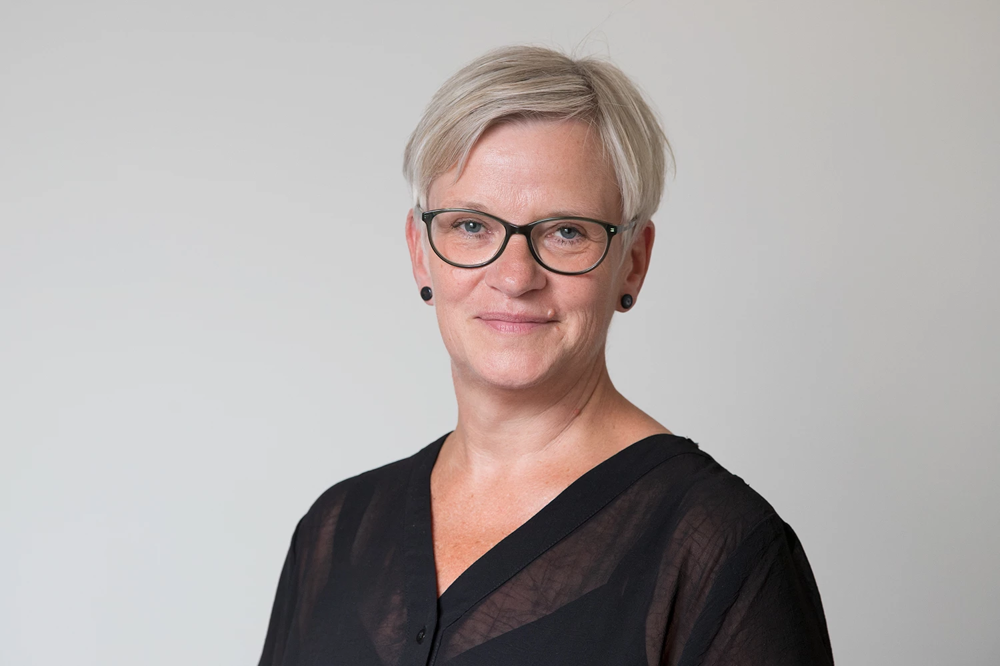

Denne arbejdspakke skaber det videnskabelige grundlag for at forstå, i hvilken grad og på hvilke områder yngre personer med type 2-diabetes er dårligere stillet end ældre. 
Ved at undersøge komorbiditet, behandling, sundhedssøgende adfærd, social ulighed, trivsel og risikoadfærd kan vi dokumentere, om personer med tidligt opstået diabetes kan opdages tidligere og modtage hurtigere og mere intensiv behandling. Kortlægning af health literacy og egenomsorgsevner vil danne fundamentet for at udvikle målrettede indsatser. 

## Læs mere om arbejdspakkens forskningsstudier

**Beskrivelse af yngre med T2D sammenlignet med ældre**

Indenfor fire områder: socioøkonomiske faktorer, sociale faktorer, adgang til sundhedsydelser og kardiometaboliske risikofaktorer sammenlignes yngre personer med T2D med ældre personer med T2D. Vi benytter Helbred i Midt kohorten, der indeholder spørgeskema- og registerdata fra flere end 20.000 personer med T2D.

**Udførende forsker:** Anette Andersen, Overlæge, ph.d. 📧 anette.andersen@rm.dk

**Sygdomsbyrde og morbiditet ved EOT2D**

I dette studie undersøges sygdomsbyrden 5 år før diagnosetidspunkt for personer, der får type 2 diabetes sammenlignet med kontroller matchet på køn og fødselsår. Alder ved diagnosetidspunkt undersøges ved at personerne deles op i grupper hvor de unge også sammenlignes med ældre. 
Sygdomsbyrden undersøges ved at se på indlæggelser og ambulante kontakter med en række diagnosekoder indenfor 6 sygdomsdomæner. De afspejler således sygdomme med en alvorsgrad der medfører kontakt til det sekundære sundhedsvæsen.
Formålet er at undersøge om unge der får type 2 diabetes adskiller sig markant fra ældre og bidrage til differentiering af behandling af de unge. 

**Udførende forsker:** Bente Kjær, Læge, ph.d. 📧 bekane@rm.dk

**EOT2D og lægesøgningsadfærd før og efter diagnosetidspunkt**

I dette studie vil vi undersøge kontakten til det primære sundhedsvæsen ved at tælle kontakter til almen praksis løbende 5 år før til 5 år efter diagnosetidspunkt. 
Vi vil sammenligne type 2 diabetikere med raske kontroller og adskille dem på køn og alder ved diagnosetidspunkt. 
Formålet er at bidrage med viden om lægesøgningsadfærd og kvalificere praktiserende lægers viden om denne sårbare gruppe.
  

**Udførende forskere:** 
-   Bente Kjær, Læge, ph.d. 📧 bekane@rm.dk

## Formidling og status
Her formidler vi løbende nyheder, indsigter og status fra arbejdet i arbejdspakke 1.

## Kontakt arbejdspakkeleder

::: {layout-ncol="2"}
-   Anette Andersen
-   Overlæge
-   Steno Diabetes Center Aarhus 
-   📧 **anette.andersen@rm.dk**

{.profile-picture}
:::

