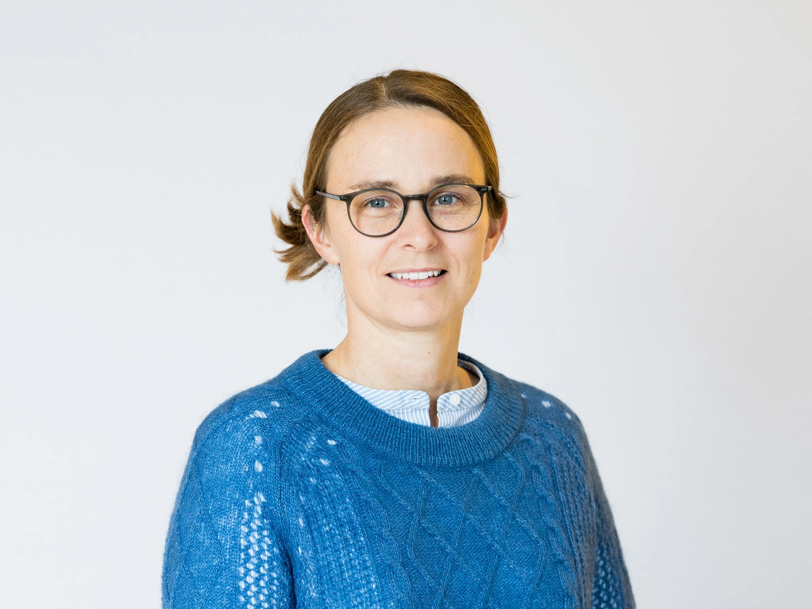
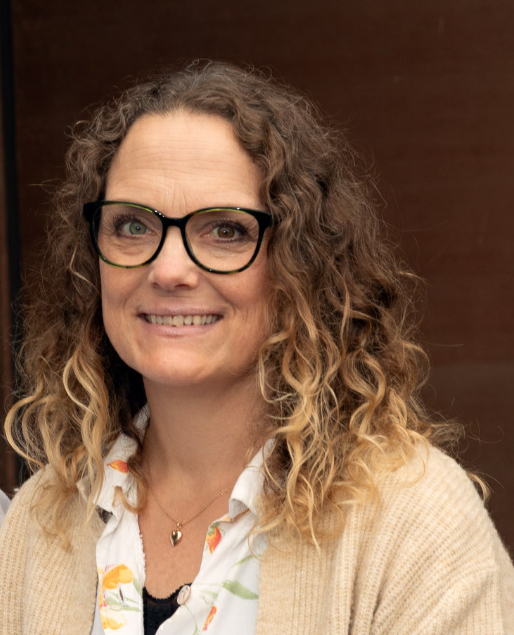

Denne arbejdspakke går i dybden og laver en omfattende karakteristik af målgruppen for at forstå sygdomsmønstre, risikofaktorer og komplikationer hos unge der får type 2 diabetes.
Ved at kombinere kliniske undersøgelser, tandlægeundersøgelse, immunologiske, metaboliske og genetiske data skabes viden der kan danne grundlag for bedre diagnostiske værktøjer samt kvalificere behandling og opsporing af type 2 diabetes tidligt i livet. 
Dette skal føre til tidligere, sikrere og mere effektiv behandling – både i Danmark og internationalt. 

## Vi skal skabe ny viden. Derfor samler vi en kohorte på 500 personer 

I 2027 laver vi i et stort kohortestudie der omfatter 500 personer med tidligt opstået type 2 diabetes. 
Deltagerne skal på ét fremmøde have lavet en række undersøgelser, som alt sammen skal gøre os klogere på, hvordan vi bedre kan behandle patienter med tidligt opstået type 2 diabetes. 

*Indsæt evt. fold ud knapper, der beskriver helbredsundersøgelsen for samarbejdspartnere* 

Læs mere om kohortestudiet og undersøgelsen her (*https://steno-aarhus.github.io/2early-patientinfo/*) 

## Formidling og status
Her formidler vi løbende nyheder, indsigter og status fra arbejdet i arbejdspakke 2. 

## Kontakt arbejdspakkeleder

::: {layout-ncol="2"}
-   Julie Støy
-   Overlæge
-   Steno Diabetes Center Aarhus 
-   📧 **julistoe@rm.dk**

{.profile-picture}
:::

## Kontakt

::: {layout-ncol="2"}
-   Bente Kjær
-   Læge, Ph.d.
-   Steno Diabetes Center Aarhus 
-   📧 **bekane@rm.dk**

{.profile-picture}
:::

