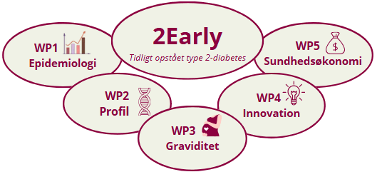
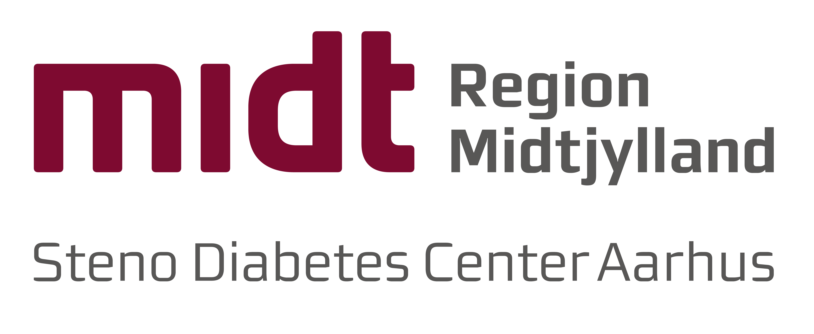

{fig-alt="Illustration af projektets arbejdspakker" fig-align="center"}

# Velkommen
Denne hjemmeside samler information om projektet **2EARLY**. 
Målgruppen for hjemmesiden er samarbejdspartnere og andre der finder interesse i at følge projektets forskning og resultater. 

**Hvad er formålet med projektet**

Tidligt debuterende type 2-diabetes (EoT2D) er en voksende og alvorlig folkesundhedsudfordring. Personer, der udvikler type 2-diabetes i en ung alder, oplever ofte en højere risiko for komplikationer, større sygdomsbyrde og en betydelig påvirkning af uddannelse, arbejdsliv og familiedannelse.

På trods af den stigende forekomst er vores viden om EoT2D fortsat begrænset. Dette projekt samler forskere og klinikere med det fælles mål at styrke forståelsen af sygdommen, forbedre diagnostik og behandling samt skabe et bedre grundlag for fremtidig forskning og klinisk praksis.

**Arbejdspakker**

Projektet består af **5 arbejdspakker**, som arbejder ind i projektets samlede formål om at styrke forståelsen af tidligt opstået type 2-diabetes og bidrage til bedre forebyggelse, diagnostik og behandling. 

**Klik på fanerne øverst på denne side, for at læse mere om hver arbejdspakke og projektets kontaktpersoner.**

{fig-alt="regionmidt logo"}
